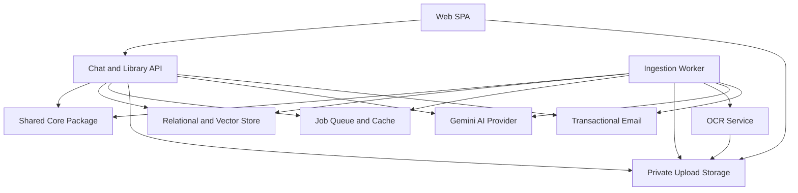
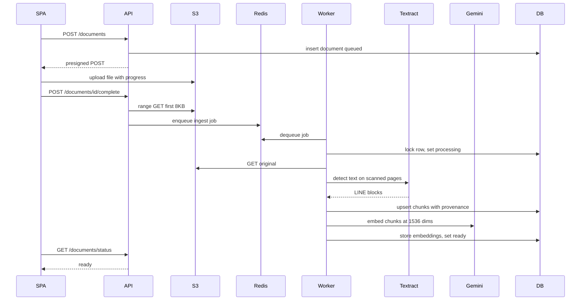
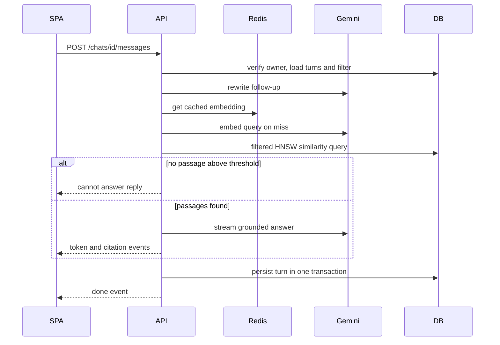
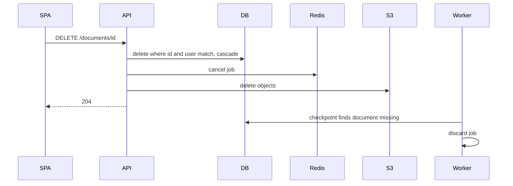
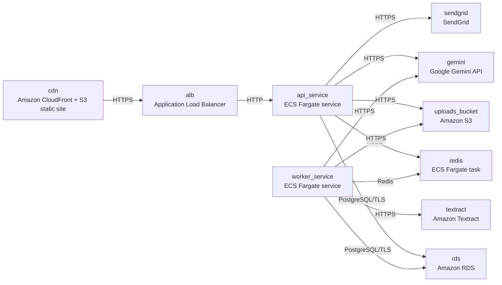

# Architecture

> Maintained by QuorQ AI SDLC. Text between `sdlc:auto` markers is regenerated; anything outside them is yours and is kept.

<!-- sdlc:auto:start narrative -->
## Overview

### ARCH-GAP · draft

No architecture or design input has been provided.

- Only the approved technology stack and service list from requirements exist.
- No architecture documents, data models, API designs or App Design screens were supplied.

**Related:** REQ-STACK, REQ-SERVICES

- ⚠ Architecture phase has not started or no input was provided.
<!-- sdlc:auto:end narrative -->

<!-- sdlc:auto:start building-blocks -->
## Building Block View

| ID | Name | Technology | Responsibility | Depends on |
|---|---|---|---|---|
| web_spa | Web SPA | React 19 SPA served from Amazon S3 behind Amazon CloudFront | Provides auth screens, the dashboard, the document library with polled status, and direct-to-S3 uploads with progress. Also provides the streaming chat view, the per-chat document filter and the citation preview panel. | api, object_store |
| api | Chat and Library API | FastAPI 0.115 on AWS ECS Fargate | Handles auth and sessions and owner-scoped CRUD for documents, chats and citations. Issues presigned URLs, validates uploads, enqueues ingestion jobs and runs the chat turn pipeline. | core_lib, database, queue, object_store, llm, email |
| ingest_worker | Ingestion Worker | Python RQ worker sharing the FastAPI 0.115 codebase on AWS ECS Fargate | Runs the ingestion pipeline: parse, OCR, chunk, embed and index. Retries with backoff, discards stale attempts, and runs a sweeper so every document ends ready or failed. | core_lib, database, queue, object_store, ocr, llm, email |
| core_lib | Shared Core Package | Python package inside the FastAPI 0.115 repository | Holds one implementation of the parsers, chunker, provenance schema, embedding helper, retrieval SQL and settings. Both the API and the worker use it. | — |
| database | Relational and Vector Store | PostgreSQL 16 with pgvector on Amazon RDS | Stores users, sessions, documents, chunks with vector(1536) embeddings, chats, filters, messages and citations. | — |
| queue | Job Queue and Cache | Redis (redis:7-alpine on ECS Fargate) | Holds RQ ingestion jobs and the failed-job registry, and caches query embeddings. | — |
| object_store | Private Upload Storage | Amazon S3 | Stores original files under users/{user_id}/documents/{document_id}/original with public access blocked. Also holds temporary Textract page subsets. | — |
| ocr | OCR Service | Amazon Textract | Runs asynchronous text detection on scanned PDF pages. | object_store |
| llm | Gemini AI Provider | Google Gemini API | Generates embeddings with gemini-embedding-001 at 1536 dimensions. Rewrites queries and streams grounded answers with gemini-2.5-flash. | — |
| email | Transactional Email | SendGrid | Sends registration confirmation and optional processing-complete notices. | — |

<!-- sdlc:auto:end building-blocks -->

<!-- sdlc:auto:start runtime -->
## Runtime View

### Upload and asynchronous ingestion

1. The SPA validates extension and size, then calls POST /documents. The API creates the document row (status queued) and returns a presigned POST with a content-length-range condition. 2. The browser uploads to S3, then calls /complete. 3. The API range-reads the first 8 KB, checks magic bytes and enqueues ingest(document_id, attempt). 4. The worker locks the row, checks the attempt counter, extracts text with pypdf, python-docx or a plain-text reader, and OCRs empty PDF pages with Textract. 5. The worker chunks the text with provenance, embeds missing vectors in batches, and sets status ready. If retries are exhausted it sets status failed with a plain-language reason. A sweeper resolves stale heartbeats.

- **Components:** web_spa, api, ingest_worker, core_lib, object_store, ocr, llm, database, queue
- **Modules:** api/routers/documents.py, api/services/upload_validation.py, worker/jobs/ingest.py, worker/sweeper.py, core/parsers/, core/ocr/textract.py, core/chunking.py, core/embeddings.py
- **Key functions:** create_upload(user, filename, size, mime), complete_upload(user, document_id), sniff_format(head_bytes, declared_type), ingest(document_id, attempt), ocr_pages(document, page_numbers), chunk(blocks, target_size, overlap), embed_missing(document_id, attempt), sweep_stale_documents()

### Grounded streaming chat turn

1. Verify the user owns the chat and load the last N turns. 2. Rewrite a follow-up into a standalone query with gemini-2.5-flash. 3. Embed the query, using the Redis cache. 4. Run one SQL query filtered by user_id, ready status and the optional document filter, ordered by cosine distance with an HNSW iterative scan. 5. Below the threshold, return a cannot_answer reply with no citations. 6. Otherwise stream a grounded answer as NDJSON, parse the P-labels it cites, and save the user message, the answer and citation snapshots in one transaction. On error, save nothing.

- **Components:** web_spa, api, core_lib, llm, queue, database
- **Modules:** api/routers/chats.py, api/services/chat_turn.py, api/services/prompting.py, core/retrieval.py
- **Key functions:** post_message(user, session_id, text), rewrite_query(turns, question), embed_query_cached(text), retrieve(user_id, query_vec, document_ids, k, threshold), stream_answer(question, passages, turns), persist_turn(session_id, user_msg, answer, citations, answer_type)

### Document deletion with full purge

In one transaction, delete the document WHERE id and user_id match (404 if no row matches). Chunks and filter rows cascade, and citations keep their snapshot with nulled FKs. After commit, cancel the RQ job and delete the S3 objects. A worker still running finds the row missing at its next checkpoint and discards its work.

- **Components:** api, database, queue, object_store, ingest_worker
- **Modules:** api/services/document_purge.py, worker/jobs/ingest.py
- **Key functions:** delete_document(user, document_id), cancel_ingest_job(job_id), purge_objects(s3_key, textract_prefix), checkpoint(document_id, attempt)

<!-- sdlc:auto:end runtime -->

<!-- sdlc:auto:start deployment-view -->
## Deployment View

| Name | Service | Runtime | Scaling | Environment |
|---|---|---|---|---|
| cdn | Amazon CloudFront + S3 static site | React 19 build | managed | dev |
| alb | Application Load Balancer | HTTPS listener | managed | dev |
| api_service | ECS Fargate service | FastAPI 0.115 on Python | 1 task in dev, CPU-based autoscaling | dev |
| worker_service | ECS Fargate service | RQ worker on Python | 1 task in dev, scales on queue depth | dev |
| redis | ECS Fargate task | redis:7-alpine | single task | dev |
| rds | Amazon RDS | PostgreSQL 16 with pgvector | single instance in dev | dev |
| uploads_bucket | Amazon S3 | private bucket | managed | dev |
| textract | Amazon Textract | managed | managed | dev |
| gemini | Google Gemini API | SaaS | managed | dev |
| sendgrid | SendGrid | SaaS | managed | dev |

| Source | Target | Protocol |
|---|---|---|
| cdn | alb | HTTPS |
| alb | api_service | HTTP |
| api_service | rds | PostgreSQL/TLS |
| worker_service | rds | PostgreSQL/TLS |
| api_service | redis | Redis |
| worker_service | redis | Redis |
| api_service | uploads_bucket | HTTPS |
| worker_service | uploads_bucket | HTTPS |
| worker_service | textract | HTTPS |
| api_service | gemini | HTTPS |
| worker_service | gemini | HTTPS |
| api_service | sendgrid | HTTPS |

<!-- sdlc:auto:end deployment-view -->

<!-- sdlc:auto:start decisions -->
## Architecture Decisions

| Layer | Choice | ADR |
|---|---|---|
| Frontend | React 19 | [ADR-0001](adr/frontend.md) |
| Backend | FastAPI 0.115 | [ADR-0002](adr/backend.md) |
| Database | PostgreSQL 16 | [ADR-0003](adr/database.md) |
| Cloud | AWS | [ADR-0004](adr/cloud.md) |
<!-- sdlc:auto:end decisions -->

<!-- sdlc:auto:start links -->
## Related Documents

- [Data Model](data-model.md)
- [API Specification](api/openapi.yaml)
- [Architecture Decision Records](adr/README.md)
<!-- sdlc:auto:end links -->
