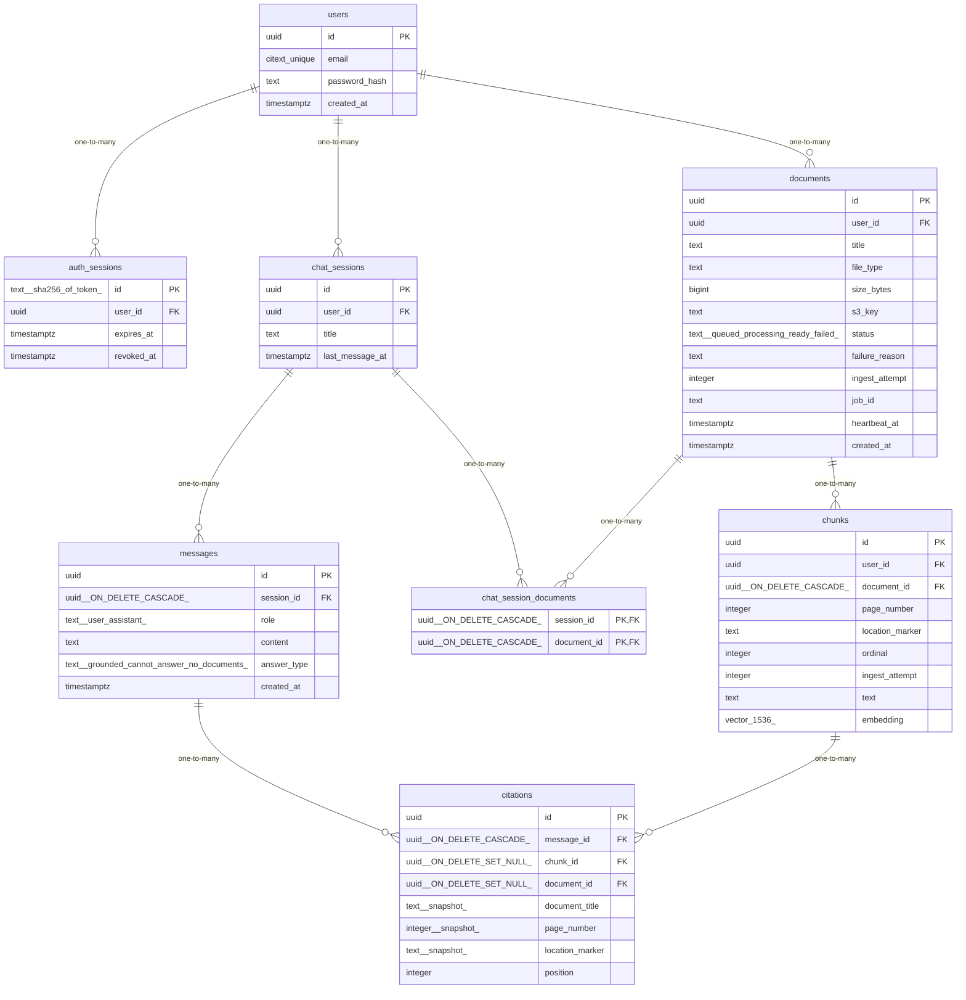

# Data Model

<!-- sdlc:auto:start entities -->
### users

| Field | Type | PK | FK | Nullable |
|---|---|---|---|---|
| id | uuid | True | — | False |
| email | citext unique | False | — | False |
| password_hash | text | False | — | False |
| created_at | timestamptz | False | — | False |

### auth_sessions

| Field | Type | PK | FK | Nullable |
|---|---|---|---|---|
| id | text (sha256 of token) | True | — | False |
| user_id | uuid | False | users.id | False |
| expires_at | timestamptz | False | — | False |
| revoked_at | timestamptz | False | — | True |

### documents

| Field | Type | PK | FK | Nullable |
|---|---|---|---|---|
| id | uuid | True | — | False |
| user_id | uuid | False | users.id | False |
| title | text | False | — | False |
| file_type | text | False | — | False |
| size_bytes | bigint | False | — | False |
| s3_key | text | False | — | False |
| status | text (queued\|processing\|ready\|failed) | False | — | False |
| failure_reason | text | False | — | True |
| ingest_attempt | integer | False | — | False |
| job_id | text | False | — | True |
| heartbeat_at | timestamptz | False | — | True |
| created_at | timestamptz | False | — | False |

### chunks

| Field | Type | PK | FK | Nullable |
|---|---|---|---|---|
| id | uuid | True | — | False |
| user_id | uuid | False | users.id | False |
| document_id | uuid (ON DELETE CASCADE) | False | documents.id | False |
| page_number | integer | False | — | True |
| location_marker | text | False | — | True |
| ordinal | integer | False | — | False |
| ingest_attempt | integer | False | — | False |
| text | text | False | — | False |
| embedding | vector(1536) | False | — | True |

### chat_sessions

| Field | Type | PK | FK | Nullable |
|---|---|---|---|---|
| id | uuid | True | — | False |
| user_id | uuid | False | users.id | False |
| title | text | False | — | False |
| last_message_at | timestamptz | False | — | True |

### chat_session_documents

| Field | Type | PK | FK | Nullable |
|---|---|---|---|---|
| session_id | uuid (ON DELETE CASCADE) | True | chat_sessions.id | False |
| document_id | uuid (ON DELETE CASCADE) | True | documents.id | False |

### messages

| Field | Type | PK | FK | Nullable |
|---|---|---|---|---|
| id | uuid | True | — | False |
| session_id | uuid (ON DELETE CASCADE) | False | chat_sessions.id | False |
| role | text (user\|assistant) | False | — | False |
| content | text | False | — | False |
| answer_type | text (grounded\|cannot_answer\|no_documents) | False | — | True |
| created_at | timestamptz | False | — | False |

### citations

| Field | Type | PK | FK | Nullable |
|---|---|---|---|---|
| id | uuid | True | — | False |
| message_id | uuid (ON DELETE CASCADE) | False | messages.id | False |
| chunk_id | uuid (ON DELETE SET NULL) | False | chunks.id | True |
| document_id | uuid (ON DELETE SET NULL) | False | documents.id | True |
| document_title | text (snapshot) | False | — | False |
| page_number | integer (snapshot) | False | — | True |
| location_marker | text (snapshot) | False | — | True |
| position | integer | False | — | False |
<!-- sdlc:auto:end entities -->

<!-- sdlc:auto:start relationships -->
| Source | Target | Type |
|---|---|---|
| users | auth_sessions | one-to-many |
| users | documents | one-to-many |
| documents | chunks | one-to-many |
| users | chat_sessions | one-to-many |
| chat_sessions | messages | one-to-many |
| chat_sessions | chat_session_documents | one-to-many |
| documents | chat_session_documents | one-to-many |
| messages | citations | one-to-many |
| chunks | citations | one-to-many |
<!-- sdlc:auto:end relationships -->

<!-- sdlc:auto:start er-diagram -->

<!-- sdlc:auto:end er-diagram -->
