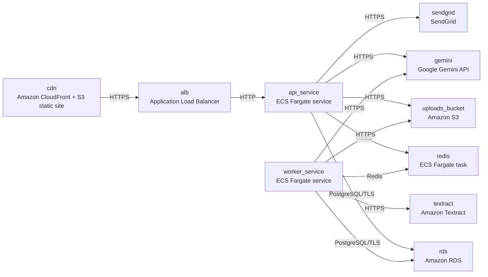

# Deployment Guide

> Maintained by QuorQ AI SDLC. Text between `sdlc:auto` markers is regenerated; anything outside them is yours and is kept.

<!-- sdlc:auto:start how-it-deploys -->
Pushes to `main` run `.github/workflows/deploy.yml`, which builds the API image (if there is a backend) and deploys the SPA to AWS Amplify. Commits touching only `docs/sdlc/**` don't deploy. Deployments can also be started from the platform's Deployment tab.
<!-- sdlc:auto:end how-it-deploys -->

<!-- sdlc:auto:start environments -->
| Name | Service | Runtime | Scaling | Environment |
|---|---|---|---|---|
| cdn | Amazon CloudFront + S3 static site | React 19 build | managed | dev |
| alb | Application Load Balancer | HTTPS listener | managed | dev |
| api_service | ECS Fargate service | FastAPI 0.115 on Python | 1 task in dev, CPU-based autoscaling | dev |
| worker_service | ECS Fargate service | RQ worker on Python | 1 task in dev, scales on queue depth | dev |
| redis | ECS Fargate task | redis:7-alpine | single task | dev |
| rds | Amazon RDS | PostgreSQL 16 with pgvector | single instance in dev | dev |
| uploads_bucket | Amazon S3 | private bucket | managed | dev |
| textract | Amazon Textract | managed | managed | dev |
| gemini | Google Gemini API | SaaS | managed | dev |
| sendgrid | SendGrid | SaaS | managed | dev |
<!-- sdlc:auto:end environments -->

<!-- sdlc:auto:start live -->
_Not deployed yet._
<!-- sdlc:auto:end live -->

<!-- sdlc:auto:start topology -->

<!-- sdlc:auto:end topology -->
